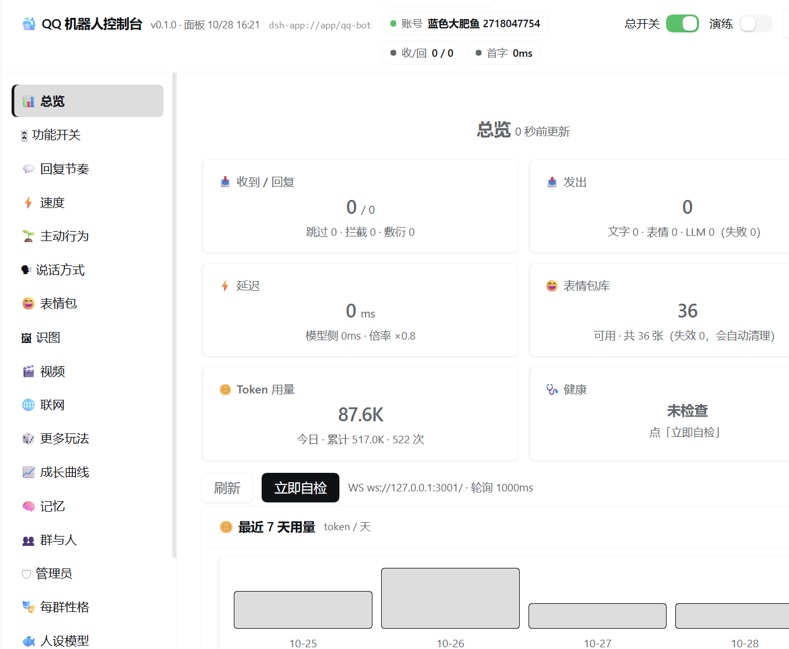

# qq-bot

> 项目名 **qq-bot**（DSH 插件包名：`@dsh-external/dsh-qq-bot`）。给 [DSH（DeepSeek Harness）](https://github.com/deepseek-ai) 用的 QQ 群拟人聊天机器人：直连 SnowLuma OneBot v11，进程内流式调用模型，自带 Web 控制台和长期记忆。

它不是"关键词问答机"：有人设、有情绪、会记事儿、看得懂图、能看视频、会发表情包，也会在没人说话时自己冒个泡——但**只在白名单群里**，其它群一律不碰。

```
QQ 群 ──▶ SnowLuma (OneBot v11) ──▶ 插件
                                    ├─ 房间状态 / 策略（概率、冷却、安静时段）
                                    ├─ 上下文（最近消息 + 长期记忆 + 情绪 + 关系）
                                    ├─ 一次流式调用 ctx.llm.stream
                                    └─ 拟人化处理（拆句 / 去 AI 味 / 长度浮动）──▶ 发送
```

一次回复默认只走**一轮**模型调用，不经过 agent 会话，首字通常 0.8~1.5 秒。

> **适合谁**：把"回得快"放在第一位的人。不想等十几秒，也不想看它在多轮工具调用里绕圈子，只希望群里那句话接得上。



> 面板挂在 DSH 里：总览 / 功能开关 / 回复节奏 / 表情包 / 识图 / 记忆 / 每群性格 / 人设模型。

## 特性

| 类别 | 能力 |
|---|---|
| 对话 | 人设、情绪状态、长度浮动、拆句、去 AI 味、@ 与引用回复、防重复 |
| 记忆 | 长期事实（相似度去重 + 归档）、画像、摘要、群内关系、每日日记 + 自述、亲密度 |
| 记忆增强 | 聊天原文归档、人物卡、每日摘要、到期跟进、语义检索（本地向量模型 `Xenova/bge-base-zh-v1.5`，不花 token） |
| 记忆深化 | 反思归纳出"更深一层的认识"、记住变化、情绪权重、「我们之间的故事」、联想、每晚整理（可撤销）、来源与把握度、偶尔想起往事 |
| 多模态 | 识图（含表情包）、视频抽帧 + 画面描述、视频链接解析、文档读取（txt/docx/xlsx/pdf）、合并转发解析、网页摘要 |
| 互动 | 小游戏（骰子/猜拳/抽签/猜谜）、投票、定时提醒、撤回、拍一拍 |
| 运维 | 面板（参数/每群性格/记忆/表情库/曲线/日志）、备份恢复、每日自动备份、用量统计、健康自检 |
| 安全 | 白名单硬约束、默认关闭、只监听 127.0.0.1、管理员遥控需二次确认 |

## 安装：把仓库地址交给 DeepSeek

装好 DSH 和 SnowLuma、在 SnowLuma 里扫码登录 QQ 之后，在 DSH 里对 DeepSeek 说：

```
帮我安装这个 QQ 机器人：https://github.com/YIYUJJ/qq-bot
按仓库里 AGENTS.md 的步骤来。群号 <群号>，管理员 QQ <你的QQ>。
```

它会下载 `main` 分支的最新代码、检查环境、**中途停下来把风险列给你确认**，然后装插件、写配置、改 SnowLuma 配置（先问你能不能重启 SnowLuma）、体检。

- **想全程不停**：一次性提供群号、管理员 QQ、是否允许重启 SnowLuma，并写明同意风险。完整模板和需要准备的东西见 [INSTALL.md](./INSTALL.md)。
- **AI 照着做的说明书**：[AGENTS.md](./AGENTS.md)（DSH 技能版：[`.agents/skills/install-qq-bot`](./.agents/skills/install-qq-bot/SKILL.md)）。
- **手动安装**：见 [INSTALL.md](./INSTALL.md#手动安装不用-ai)。

### 第一次配置

在 DSH 左侧栏点「QQ 机器人」（小鲸鱼图标）打开面板（3101 是推送端口，不是面板），至少确认：

| 配置 | 说明 |
|---|---|
| `enabled` | 总开关，默认关 |
| `allowGroups` | 允许回复的群号，**默认空 = 谁都不回** |
| `adminQQ` | 管理员 QQ：可私聊遥控、可让它撤回 |
| `memoryRooms` | 要维护长期记忆的群/私聊 |
| `snBase` / `snToken` | SnowLuma 的 HTTP 地址与 token |

配置保存在 `~/.dsh/qq-bot/config.json`（Windows：`C:\Users\<你>\.dsh\qq-bot\`）。

## 配置

- **全局**：面板参数页，或直接改 `config.json`
- **每群性格**：面板「每群性格」页，只允许覆盖表达层参数；白名单、模型路由、接入地址不可按群覆盖
- **模型**：`provider` / `model` 留空会用 DSH 当前默认模型；识图可单独指定 `visionProvider` / `visionModel`

所有配置项的中文说明集中在 `lib/meta.mjs`，面板直接读它渲染。

## 开发与测试

```bash
node scripts/run-tests.mjs   # 全部单元 + 集成测试（69 套）
node scripts/smoke.mjs       # 冒烟：语法 → 配置一致性 → 依赖审计 → 插件存活 → 网关/端口
node scripts/smoke.mjs --quick
node scripts/doctor.mjs      # 环境体检：配置/连接/白名单/模型路由/日志
node build-client.mjs        # 改完 panel/index.html 必须重跑
```

## 目录

```
lib/
  index.js          插件入口：装配模块、挂事件、注册工具、启动
  rooms.mjs         每群配置覆盖 + 会话状态 + 白名单闸
  config-store.mjs  配置读写 / 校验 / 热重载
  state-init.mjs    持久化容器（facts / stickers / usage / replied / outbox）
  memory-store.mjs  长期记忆存储     memory-ai.mjs  记忆的模型侧
  memory-auto.mjs   自动记忆维护     prompt.mjs     人设 / 情绪 / 系统提示词
  memory-plus.mjs   记忆增强（原文归档 chat-log / 人物卡 / 每日摘要 / 跟进），embed.mjs 语义检索
  deep*.mjs / memory-deep.mjs   记忆深化（反思 / 变化线 / 故事 / 联想 / 每晚整理 / 想起往事）
  decision.mjs      回复决策         model.mjs      模型调用与路由
  notes.mjs         链接 / 搜索笔记  vision.mjs     识图链路
  video-chain.mjs   视频抽帧描述     media.mjs      识图缓存 / 媒体 key / ffmpeg
  sticker-store.mjs 图库持久化       sticker-net.mjs 图库收发
  polling.mjs       轮询兜底         scheduler.mjs  主动说话 + 定时器
  startup.mjs       启动序列         ops.mjs        运维 + 备份 / 重启
  panel.mjs         面板数据         panel-mount.mjs 面板挂载
  http-api.mjs      面板 API         register-tools.mjs 工具注册
  schema.mjs / meta.mjs     配置单一真相 / 面板元数据
  safe.mjs / store.mjs / metrics.mjs   错误隔离 / 原子写 / 指标
  features.mjs / extras.mjs / policy.mjs / humanize.mjs   玩法 / 工具 / 拆句 / 去 AI 味
panel/              面板源码（构建产物 lib/client.js）
scripts/            run-tests / smoke / doctor / setup
tools/              audit-config-types / check-module-deps / probe-apply / static-scan
docs/               ARCHITECTURE / TESTING / PITFALLS
```

## 已知限制

- 只在 **Windows** 上验证过；路径与进程调用按 Windows 写，Linux/macOS 需要小改
- docx/xlsx 依赖本机 Python；PDF 需要 `pypdf`，第一次读时自动装到数据目录
- 视频链接依赖 `yt-dlp`，抽帧依赖 `ffmpeg`
- 还不支持语音条（没有 ASR）
- 没有并发压测；设计目标是情侣/小群，不是大群

## 安全边界

- 只有 `allowGroups` / `allowPrivate` 里的会话会被回复
- `enabled` 默认 `false`
- HTTP 服务只绑 `127.0.0.1`
- 管理员指令需要二次确认
- **不要提交** `~/.dsh/qq-bot/config.json`（里面有 token）

## 文档

- [INSTALL.md](./INSTALL.md)：给人看的安装步骤
- [AGENTS.md](./AGENTS.md)：给 AI 看的安装流程
- [docs/ARCHITECTURE.md](./docs/ARCHITECTURE.md)：模块边界与依赖规则
- [docs/TESTING.md](./docs/TESTING.md)：测试与排查手册
- [docs/PITFALLS.md](./docs/PITFALLS.md)：踩坑记录（含已加的检查）

## License

MIT
